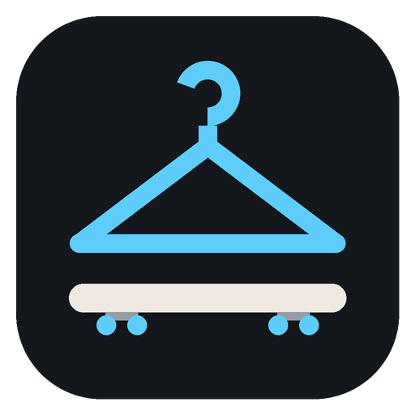
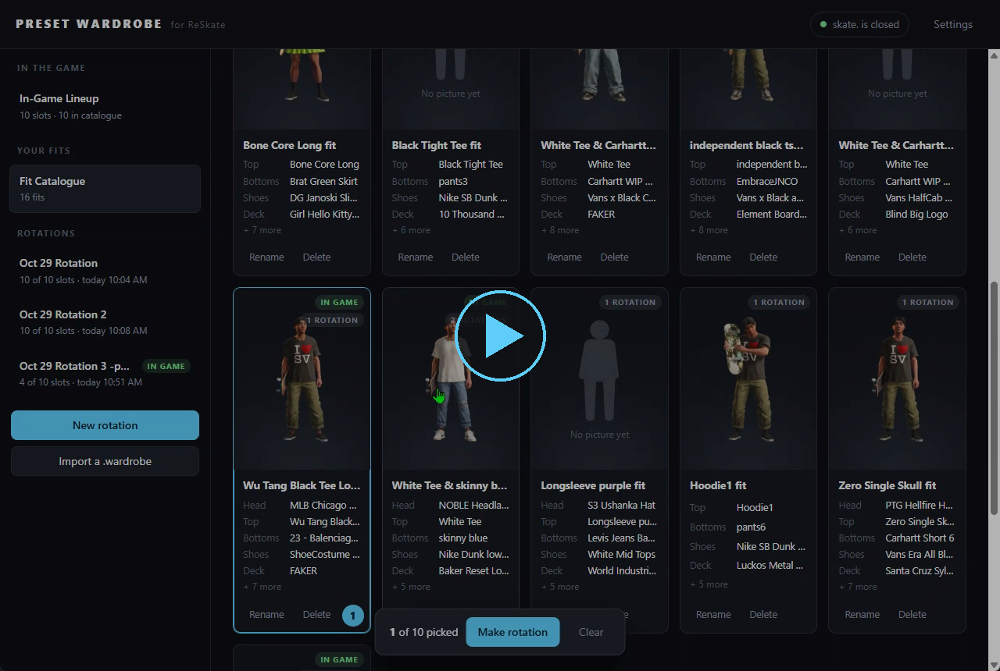
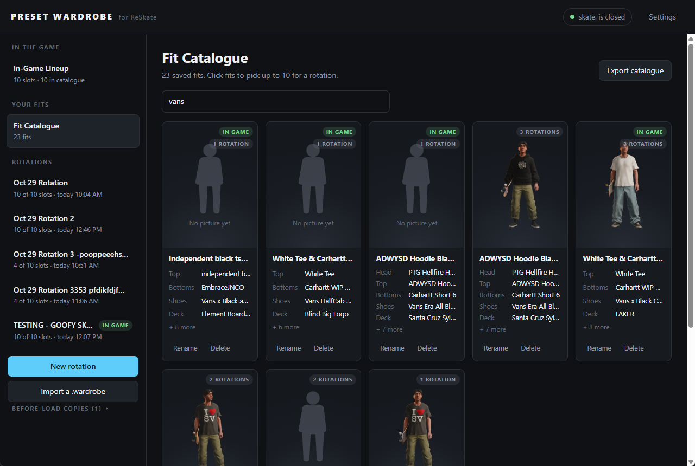

# Preset Wardrobe

Preset Wardrobe is a lightweight plugin and companion app for ReSkate, which allows you to catalogue
your in-game presets (how your skater looks, the clothing they wear and the full board setup), along
with a screenshot feature that provides a preview image of each fit in the companion app.

**[Download the latest release](../../releases/latest)**

## See it in action

## Requirements

- Windows 10 or 11
- ReSkate 2.1.3 or newer
- Microsoft Edge WebView2 (already on Windows 11, and on Windows 10 with Edge installed)

## Installing and usage

1. Download the release `.zip` and unzip it somewhere.
2. Inside that folder will be another `.zip` (the ReSkate plugin) and the companion app (a `.exe`).
3. Install the plugin with the ReSkate Launcher: **MODS > Install .zip**.
4. Open the companion app and leave it open in the background while you catalogue your fits.
   If Windows shows "Windows protected your PC", click **More info > Run anyway**.
5. Open ReSkate and click **Turn on** when you get a prompt about the plugin's permissions.
6. Go to the **Skaters** page. From here you have two choices:
   - **One at a time:** select a preset and press **F8** (or hit **Insert** and use
     **PLUGINS > Preset Wardrobe > Snap the selected preset**). Change your outfit in between and
     snap again. You can catalogue as many fits as you want.
   - **10 at a time:** hit **Insert**, go to **PLUGINS > Preset Wardrobe > Walk through all slots**,
     then highlight your first (leftmost) preset and follow the directions on screen.
7. Open the companion app. Go to **In-Game Lineup** to see your current 10 presets, or to
   **Fit Catalogue** to see every fit you've saved.
8. In the Fit Catalogue, select fits (up to 10 at a time), click **Make rotation** and give it a name.
9. Close skate.
10. Select your rotation from the sidebar in the app and click **Load into game**.
11. Start skate., load in and enjoy.

## Reporting bugs

Found a bug? [Open an issue](../../issues/new/choose) and fill in the bug report form.

## Credits

- Created by **[jrkmods](https://thunderstore.io/c/reskate/p/jrkmods/)**, also known as [codeonthesun](https://github.com/codeonthesun) here on GitHub
- Built on the [ReSkate](https://github.com/Dingo-Shenanigans/ReSkate) plugin API

## License

[MIT](LICENSE)

## Disclaimer

Preset Wardrobe is a fan-made project and is not affiliated with EA, Full Circle or the ReSkate team.
