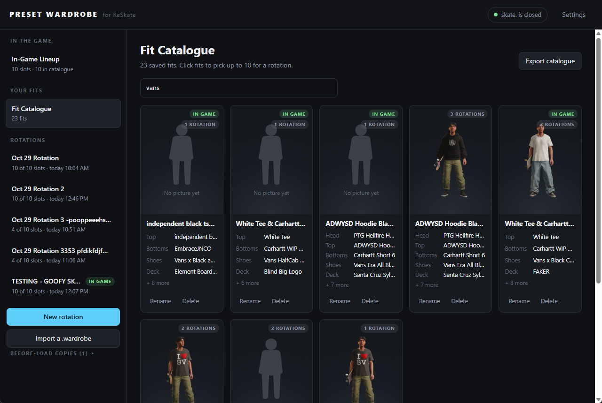

# Preset Wardrobe

Preset Wardrobe is a lightweight plugin and companion app for ReSkate, which allows you to catalogue
your in-game presets (how your skater looks, the clothing they wear and the full board setup), along
with a screenshot feature that provides a preview image of each fit in the companion app.

**[Download the latest release](../../releases/latest)**

## Key features

- **Instant live loading, everywhere.** Load a fit while skate. is running and your skater and board change on the spot: in the world, on the Skaters page, and on online servers. It lasts through map changes, joining and leaving servers, and restarts.
- **Snap fits from inside the game.** Press your snap key (or hold <kbd>Y</kbd> on a controller) on the Skaters page and the outfit is saved to your Fit Catalogue with pictures, no alt-tabbing.
- **Spinning 360° previews.** Every snap turns your skater a full circle and takes four pictures of the board, so you can see backs, backpacks and graphics. Drag any picture to turn it. Sharper HQ copies are made quietly in the background.
- **Knows what you're wearing.** A card on the Skaters page tells you whether the preset on screen is already in your catalogue, has pictures, or isn't saved yet, and lists its pieces by their real names.
- **Rotations.** Build sets of up to 10 fits and load a whole lineup into the game at once, or swap one fit into a single slot.
- **Safe by design.** Every change to skate.'s save is backed up first and checked after it's written, and every load can be undone.
- **Mix & match.** Make a new fit from one fit's skater and another fit's board.
- **Share your fits.** Export a rotation or your whole catalogue as a `.wardrobe` file, pictures included, and import other people's.

## Watch the demo

https://github.com/user-attachments/assets/a372fac2-f642-41f4-9064-8ea062ca3b5d

## Requirements

- Windows 10 or 11
- ReSkate 2.1.3 or newer
- Microsoft Edge WebView2 (already on Windows 11, and on Windows 10 with Edge installed)

## Installing and usage

1. Download the release `.zip` and unzip it somewhere.
2. Inside that folder will be another `.zip` (the ReSkate plugin) and the companion app (a `.exe`).
3. Install the plugin with the ReSkate Launcher: **MODS > Install .zip**.
4. Open the companion app and leave it open in the background while you catalogue your fits.
   If Windows shows "Windows protected your PC", click **More info > Run anyway**.
5. Open ReSkate and click **Turn on** when you get a prompt about the plugin's permissions.
6. Go to the **Skaters** page. From here you have two choices:
   - **One at a time:** select a preset and press **F8** (or hold **Y** on a controller; or hit **Insert** and use
     **PLUGINS > Preset Wardrobe > Snap the selected preset**). Change your outfit in between and
     snap again. You can catalogue as many fits as you want.
   - **10 at a time:** coming later. It's a work in progress and switched off in the plugin for now.
7. Open the companion app. Go to **In-Game Lineup** to see your current 10 presets, or to
   **Fit Catalogue** to see every fit you've saved.
8. In the Fit Catalogue, select fits (up to 10 at a time), click **Make rotation** and give it a name.
9. Close skate.
10. Select your rotation from the sidebar in the app and click **Load into game**.
11. Start skate., load in and enjoy.

## Reporting bugs

Found a bug? [Open an issue](../../issues/new/choose) and fill in the bug report form.

## Credits

- Created by **[jrkmods](https://thunderstore.io/c/reskate/p/jrkmods/)**, also known as [codeonthesun](https://github.com/codeonthesun) here on GitHub
- Built on the [ReSkate](https://github.com/Dingo-Shenanigans/ReSkate) plugin API
- Assistance from Claude Ai 

## License

[MIT](LICENSE)

## Disclaimer

Preset Wardrobe is a fan-made project and is not affiliated with EA, Full Circle or the ReSkate team.
